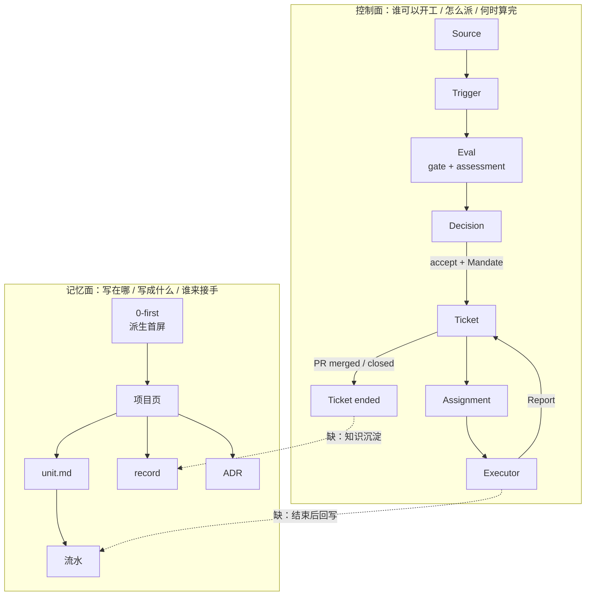

# DSH-SuperAgent 与 Windows Hermes / DaN 架构对比

> 读取时间：2026-11-02。对象：本机 WSL2 上运行的 DSH-SuperAgent（`@deepseek-ai/dsh` 0.2.1-rc.3 + `dsh-superagent-prototype`），以及 Windows 侧 `D:\hermes` + `D:\AgentWork` 的 Hermes / DaN 体系。
>
> 本文只做架构层面的比对，不展开具体项目内容；引用的项目文件只用于说明机制。
>
> 中文版：正文、PR 说明与提交信息以中文为主；首行为自动化披露固定语；专有名词、代码标识符和引用原文保留原样。

---

## 0. 一句话结论

**DaN 与 SuperAgent 不在同一层，不能互相替代。**

- **DaN 是“记忆面 / 记录面”**：解决“这件事写在哪、写成什么形状、下一个人从哪接手”。它的对象是文档，状态是 Markdown + git，控制靠人的判断分级（L0–L3）和 cron。
- **SuperAgent 是“控制面”**：解决“谁有权开工、这件事怎么派出去、什么时候才算真的做完”。它的对象是事件与工单，状态是 SQLite，控制靠代码强制的 gate + policy + assignment 生命周期。

两者在功能上正交。DaN 的短板恰好是 SuperAgent 的长板（外部完成锚、入口授权、结构化报告）；SuperAgent 的短板恰好是 DaN 的长板（跨会话项目记忆、可读的长期记录、按决策重量分层）。

**但“互补”是功能互补，不是可靠性互补。** DaN 的记录靠写作者的纪律；本机观察（2026-11-05）是：新建 agent 不服从派单纪律，决策矩阵只在被提醒时才用，lint 天天报错、已经被挤爆。SuperAgent 的结构是程序化的（issue / ticket / PR / 完成锚），可靠性更高；但它没有跨工单记忆，router 也会遇到相似项目的分流问题。详见 §1.4 与 §8。

**最值得搬的不是形状，而是五个机制**：①完成锚 ②落点强制 ③结构化报告 ④注意力预算 ⑤角色分离。把 SuperAgent 的工单状态机整体搬到 DaN，既不必要，也不成立。

---

## 1. 两套系统各是什么

### 1.1 DSH-SuperAgent：事件驱动的授权与执行控制面

核心流水线（`dsh-superagent-prototype/docs/001-domain.md`）：

```
Source ──Trigger──▶ Thread ──batch──▶ Eval ──accept + Mandate──▶ Ticket ──Assignment──▶ Executor
  │                    │                 │                          │                      │
  │                    └── Subscription 扇出 ──────────────────────▶│                      │
  │                                                                  └── Channel ◀── Report ┘
  └── 读位置 / 身份                                                   （回原会话）
```

关键对象与规则：

| 对象 | 作用 | 关键约束 |
|---|---|---|
| Source | 事件来源（GitHub / 飞书） | 自己记读位置、自己的 bot 身份；启动不重放 |
| Trigger | 一条不可变事件 | 属于一个或多个 Thread；重复接受只产生一张 Ticket |
| Thread | 按时间排的 Trigger | 同一 Thread 同一时刻只跑一个 Eval；可挂多张 Ticket |
| Eval | 判断“要不要开工” | **两层**：gate（程序：allowlist / admission / 是否 @）→ assessment（模型） |
| Decision | Eval 的结果 | `accept` / `stop` / `ignore` / `unavailable` |
| Mandate | accept 授予的授权 | 不可变；记录 policy 版本、范围、强度、匹配规则；只有人的 stop 或 revalidation 失败能撤销 |
| Ticket | 一个被授权的工作单元 | **只有 Eval 能创建**；有自己的状态机；绑定 PR 时由 PR 的合并/关闭结束 |
| Assignment | Ticket 与一次 Executor 实例的绑定 | `pending → running → ended`，与 Ticket 生命周期独立 |
| Subscription | Ticket 与 Thread 的多对多关系 | 后续消息作为上下文扇入，**不授予新权力**；机器人/CI 不唤醒已结束 Ticket |
| Report | Executor 交回的结构化状态 | `progress / waiting / ready / blocked / failed / dropped` + 一个人工问题字段 |

七个 Ticket 阶段，按“在等谁”划分（`docs/003-execution.md`）：`person/delivery`、`person/answer`、`person/review`、`person/blocked|failed`、`working/queued`、`idle`、`working`。

**完成判定是这套架构的核心**：`ready` 报告不结束 Ticket；绑了 PR 的 Ticket 要等它打开的 PR 全部合并/关闭，才落 `ended{outcome:"merged"}`。worker 自报“我做完了”没有用，外部对象（PR 状态）才是锚。

### 1.2 Windows Hermes + DaN：长期助手的记忆面

Hermes 是单进程的 Python agent 宿主：单层 while + 定序 phase，messages + SQLite 增量持久化，SOUL / AGENTS / MEMORY / USER / 技能索引每轮拼进 system prompt，技能正文按需 `skill_view`，cron 是主要的自动触发，profile 隔离人格/记忆/技能并给默认工作区（`ADR-0013` 的实测对比）。

DaN（Doc as Node）是在 Hermes 之上长出来的一套**文档拓扑与写入纪律**：

```
SOUL / AGENTS / MEMORY / USER / 技能索引        ← 每轮自动注入
        │
        ▼
0-first.md（派生首屏：在办 / 待决策 / 停滞）    ← first-screen.py 从 projects/*.md + decisions/*.md 生成
        │
        ▼
项目页.md（status / next / last_progress / 判据 / 边界）
        │
        ├── unit.md（目标 / 做什么 / 不做什么 / 接手清单 / 验收判据 / 边界 / 文档地图）
        │       └── YYYY-MM/流水.md（一行一步，带时分）
        ├── record（没有中间状态的事实/证据，不建目录）
        └── ADR（拍过板的裁决，六段 + 冻结 + supersedes）
```

写入分五层（`ADR-0079` / `DaN结构表.csv`）：

| 层 | 判据 | 落点 | 是否冻结 |
|---|---|---|---|
| log | 一个动作，做完就过 | `<项目>/<月>/流水.md` 一行 | 否 |
| record | 没有中间状态，只能说出“我观察到什么” | `<项目>/<月>/YYYY-MM-DD-slug.md` | 否 |
| unit | **有中间状态**，说得出“我做到哪了” | `<项目>/<slug>/unit.md` + 流水 | 否 |
| adr | 用户拍了板（三条门槛：有被否决的备选 / 跨项目 / 半年后有人问；D3 由 L3 承担） | `plans/decisions/ADR-00xx-*.md` | 是（人 accept） |
| ref | 被 unit / adr 引用的依据 | `plans/refs/` | 否 |

决策与授权走 L0–L3 矩阵（`D:\AgentWork\AGENTS.md` §2）：L0 自决写 log，L1 写 record/unit，L2 先报后动，L3 停手即报 + ADR 冻结。**判级看两轴：作用半径（S1–S4）× 破坏性（D1–D3）**。

这套体系真正解决的是“**跨会话、跨天的连续性**”：新会话不需要原对话，只要读 `0-first` → 项目页 → `unit.md` + `流水`，就能回答“这条线是什么、做到哪、下一步是什么”。

但这是设计目标，不是已兑现的事实。实际能否做到，取决于写入纪律与 lint 之外的检查。本机观察（2026-11-05）是：新建 agent 不服从派单纪律，决策矩阵只在被提醒时用，lint 已被报错挤爆——这说明“有树”不等于“树是可信的”。

> 这套体系本身也在演化：原稿（2026-10-26）设想按被引用次数升 `hub-note`，`ADR-0071` 否决了这一层；`ADR-0079` 又把 `note` 拆成 `unit`/`record`，判据从“会不会跨会话”改成“有没有中间状态”。方向是从“拓扑后验”收敛到“当场可判”——这也解释了为什么它更像记录纪律，而不是执行引擎。

### 1.3 一张图看层次差异



图中两条虚线就是本文要讨论的核心：**SuperAgent 的“结束”在 DaN 里没有落点；DaN 的“完成”没有外部锚。**

### 1.4 跨对话继续：Ticket 级 vs 项目级

前文没有把“继续”拆开，容易让人以为 SuperAgent 也有一套跨项目的长期记忆。实际不是。

**SuperAgent 的继续单位是 Ticket，不是对话。**

- 对话（Thread）只是输入源；Ticket 才是持久对象。Ticket 的阶段、Mandate、Subscriptions、待投递的 Input、已存储的 work 都在 SQLite 里，进程重启后还在（`003-execution.md` 的 Failure and recovery）。
- 每个 Ticket 一个 Executor Session，名为 `worker-<ticket id>`；retry 会“start a new Assignment in the same Executor Session, directory, branch and pull request”；重启后 session 和目录仍在，新 Assignment 带一条 recovery note，要求先查目录、git 历史、GitHub，再决定是否重复外部动作。
- 新 Assignment 会拿到前任没取走的 Input；已经取走但没处理的，按“已读/未读”规则处理；同一份消息不会重复投递。
- 人可以在原 Thread 上继续说话，订阅把消息扇入 Ticket；也可以直接在 Executor Session 里写。Ticket 结束后订阅仍在，人的新消息在 policy 允许时可以恢复它。
- 但**没有跨 Ticket 的语义记忆**：新 Ticket 从自己的 Mandate/Inputs 开始；router 的 assessment 只读有界的 source context；旧 Ticket 的对话不会自动成为新 Ticket 的知识。准确说，这是“同一 Ticket 跨 Session、跨重启、跨多次派工继续”，不是“跨项目记住”。

**DaN 的继续单位是项目 / unit，不是一次工单。**

- 新会话读 `0-first` → 项目页 → `unit.md` + `流水`，就能接手；这是跨天、跨会话、跨 agent 的连续性。
- 但载体是 Markdown，写入靠纪律；没有外部锚，也没有程序化的“未完成”检查。项目页/流水可以写得很好，也可以腐烂；lint 只查结构，不查真假。

| | SuperAgent | DaN |
|---|---|---|
| 继续单位 | Ticket | 项目 / unit |
| 载体 | SQLite + Ticket 目录 + Executor Session | Markdown + git |
| 新会话从哪开始 | Ticket 卡 / Mandate / Inputs / Reports | 0-first → 项目页 → unit/流水 |
| 跨工单记忆 | 无（只有 domain store / 面板） | 有（项目树） |
| 主要失败模式 | 工单结束即知识蒸发；相似工单分流 | 文档腐烂；记录缺失；自律失效 |

**结论**：SuperAgent 的强项是“同一件事不会因为换会话而丢”，弱项是“不同的事之间不共享记忆”；DaN 正相反。前文说“互补”，指的只是这个功能分工，不是可靠性对等；可靠性问题见 §8.1。

---

## 2. 概念对照

| DSH-SuperAgent | Hermes / DaN | 对应关系与差异 |
|---|---|---|
| Source | 会话渠道 / cron / 文件系统 | SuperAgent 只认显式事件源；Hermes 的主要“源”是人开口和定时器 |
| Trigger | 一条用户消息 / 一次 cron 触发 | 都要求不可变、可审计；DaN 没有 Trigger 实体，只有流水行 |
| Thread | 会话 / 话题线程 / 项目线 | SuperAgent 的 Thread 是事件序列；DaN 的项目是**反馈回路**（J13），不是同一回事 |
| Eval（gate + assessment） | 人的判断 + L0–L3 矩阵 | SuperAgent 用代码 gate + 模型 assessment；DaN 用人的分级 + 文本纪律 |
| Decision | 拍板 / 项目页 `next` | SuperAgent 的 Decision 有枚举与理由；DaN 的“决定”分散在 ADR、项目页、流水 |
| Mandate | 授权票据（范围 × 时效 × 半径）+ 项目页 `next` | SuperAgent 的 Mandate 不可变、带 policy 版本；DaN 的授权靠人话和判据 |
| Ticket | unit / 工单 | **一次性 vs 可接手**，这是最大的形状差异 |
| Assignment | 一次会话 / 一个 worker | SuperAgent 一票可多次派工；DaN 的 unit 由任意会话接手 |
| Subscription | 关注 / 项目线 | SuperAgent 订阅是“消息扇入、不授权”；DaN 没有等价物 |
| Report | 流水 + 回执 | SuperAgent 是结构化 schema；DaN 是一行自然语言 + 判据指针 |
| Attention | 待拍板 / 问题卡 | SuperAgent 有 `human_action` 字段；DaN 靠 0-first 的“待决策”段 |
| Policy | AGENTS + 决策矩阵 + skills | SuperAgent 的 Policy 可版本化、会被 gate 执行；DaN 的规则多数靠自觉 |
| Channel | 飞书 / GitHub / 项目页 | SuperAgent 写回原会话；DaN 写回项目树 |
| Panel | 0-first + 项目页 + 看板 | SuperAgent 面板优先“需要人的事”；0-first 是“全项目状态” |

一句话：**SuperAgent 的每个对象都围绕“授权与生命周期”，DaN 的每个对象都围绕“记录与接手”。**

---

## 3. 十个维度

### 3.1 目标函数

| | DSH-SuperAgent | Hermes / DaN |
|---|---|---|
| 优化目标 | 用最少的人注意力，换最大的可交付价值 | 用最少的重复解释，换最长线的连续性 |
| 成功指标 | 人只在必须时被打断；工单按外部锚结束 | 新会话不用问原对话就能接手；项目状态一眼可见 |
| 失败形态 | 漏触发、错派、假完成、噪音消息 | 记录腐烂、断链、自报完成、项目页没人读 |

两者都把“人的注意力”当稀缺资源，但**节省的方式不同**：SuperAgent 靠“少说话 + 结构化提问”；DaN 靠“把状态写下来，让人/下一个 agent 自己读”。

### 3.2 工作单元与生命周期

- **SuperAgent 的 Ticket 是一次性的**：从 Trigger 来，到 PR 合并/关闭止；目录是工作目录，不是知识库。
- **DaN 的 unit 是可接手的**：它没有宿主强制的结束状态，只有 `status` 和流水；它可以被任意会话继续，甚至被后来的会话重新解释。
- **判断标准不同**：SuperAgent 问“这件事被授权了吗、做完没有”；DaN 问“这件事有没有中间状态、下一个人能不能从这里开始”。

这决定了两个系统的“记忆”位置：SuperAgent 的记忆在 Ticket/Assignment/Report 的表里，随部署走；DaN 的记忆在项目树里，随 git 走。

### 3.3 授权与决策分级

**SuperAgent 的授权是结构性的**：

- gate 是程序：allowlist / admission 表 / 是否 @ / 是否 bot / 是否 `off` 模式；不通过就没有候选。
- assessment 是模型：只在 gate 通过后判断“这算不算新工作”。
- accept 产生不可变 Mandate；policy 变更不撤销在跑的 Mandate，只在恢复前 revalidate。
- 主动工作（inferred）默认 `observe`，只记录“本来会 accept”，不执行。

**DaN 的授权是判断性的**：

- L0–L3 按作用半径 × 破坏性分级；L0/L1 自决，L2 先报后动，L3 停手 + ADR。
- 授权票据（范围 × 时效 × 半径）来自人；红线（凭据、对外发出、不可逆删除）不放宽。
- 没有代码 gate；执行面靠 AGENTS 全文注入 + 人的复核 + lint 的部分检查。
- **角色分离靠纪律，不靠工具**：DaN 已有“default 不自己跑卡”的派单纪律，但没有 DSH 那种 router/worker 的 preset、工具白名单与 prompt 级隔离。

**结论**：SuperAgent 管“入口”，DaN 管“动作重量”。两者不是替代，而是前后两道门。DaN 如果把“谁能起活”也做成代码 gate，会过重；SuperAgent 如果把“动作能不能做”也塞进 Policy，会越界（它的文档明确说“对自身结果的约束属于 agent 指令，不是 Policy”）。

### 3.4 触发与入口

| | SuperAgent | Hermes / DaN |
|---|---|---|
| 主触发 | 外部事件（GitHub notification / 飞书消息） | 人开口 + cron + 少量事件（文件/脚本） |
| 入口控制 | Source 配置：读哪些群、哪些仓库、是否收全部消息 | 会话 cwd / profile / AGENTS 链；cron prompt |
| 幂等 | Trigger 只存一次；重复接受只产生一张 Ticket | 靠人去重；流水可能重复写 |
| 漏触发 | 有 `unavailable` / `timeout` / `filtered` 记录可查 | 没有统一台账；靠 0-first 的“停滞”段和 solidify-check 事后发现 |

SuperAgent 的强项是“**进来的东西不会悄悄消失**”：即使 ignore，也留 Decision 和理由。DaN 的强项是“**没进来的东西也能被想起**”：0-first 会把停滞项目列出来，cron 会按 unit 目标继续推进。

### 3.5 读取面：两种“进场”

**Hermes 的读取链是“拉”**（`ADR-0039` R3.3）：

1. SOUL（身份）
2. AGENTS（纪律，目录链全文注入）
3. 技能索引（只有 name + description）
4. MEMORY / USER（缓冲区）
5. `0-first`（在办一览）
6. 项目页（status / next / cluster）
7. `clusters.md`（这条线该带哪些技能）
8. 技能正文（按需 `skill_view`）

①–④ 自动，⑤–⑧ 按需。**没有 force-load**：技能正文不会自动进 prompt，项目页也不进 prompt；所以“必读”只能靠纪律和 0-first 的指引。

> 注意：ADR-0039 是早期版本，未包含 DaN 项目页/项目页 Agent；当前读取面以 `0-first` + 项目页 + `unit.md` 为准（见 §8.6 与 2026-10-22 清单）。

本机的《开局读取面清单》（2026-10-22 实测）把这件事量化了：自动注入 7 项（SOUL、内建纪律、cwd 规则、技能清单、MEMORY、USER、运行时块），被指引去读 8 项，其中 3 处断链/空洞；技能清单占可编辑注入层的 51%。这说明“拉”不是免费的：它需要一份清单、一个首屏、和持续的断链检查。该清单是 2026-10-22 的快照（后续已有改动），这里引用的是结构，不是当前数字。

**SuperAgent 的读取链是“推”**：

- 主 Session：内置角色 + 团队三段 + 订阅/回复 + 派单 + admission + handoff + 环境 + policy，全部自动拼装；assessment 只读有界 source context。
- Executor：同一套 prompt + 工单上下文（Trigger、Inputs、Reports）+ DSH 的 coding prompt + 仓库 `AGENTS.md`；技能仍按需加载。
- **主 Session 不读仓库 AGENTS**（执行者才读）。效果上是把“路由规则”和“工作区规则”分开，避免路由被具体仓库的纪律带偏。这是一个刻意的分工。

**一个共同的短板**：两边的技能加载机制相同——只有 name + description 进 prompt，正文按需加载。所以“技能描述就在注入面、但该技能从未被调用”这类失败（`ADR-0013` 记录的 85% 选择失败）不是 SuperAgent 能修的架构差异，换底座不会改善。

**最深的差异**：Hermes 假设“有一个长期助手，需要知道我是谁、我做过什么”；SuperAgent 假设“有一个可替换的工人，只需要知道这单的授权和上下文”。所以 DaN 有 SOUL / MEMORY / 0-first，SuperAgent 有 Mandate / Policy / Ticket dir。

### 3.6 完成判定

这是两者差距最大的一项。

**SuperAgent**：

- `ready` 只是“可审”，不是“完成”。
- 绑 PR 的 Ticket 等 PR 合并/关闭；`followsDone` 决定是否真的结束。
- `dropped` 是“无需处理”，不是“做完”。
- 结束记录 `ended{by, outcome}`，`outcome` 来自外部对象，不来自 worker 自报。
- 反例实测：worker 报“工单已完成并交付”，Ticket 不结束；直到 PR 真的 merged 才落 `ended`。

**DaN**：

- `status`、`流水`、`判据` 都是人/agent 写的判断；lint 只查结构，不查真假。
- 已有的“完成”多半是自报：工单有回执，但回执没有可核对象。
- 这正是 `落账与路由/落账卡口/unit.md` 判据 6 要修的：“每张在办单有可核的完成锚，且锚不由执行者自判；无锚的单只能标‘已交付待核’。”

**可迁移的结论**：完成锚不必是 PR。它可以是**验收命令的输出、文件哈希、外部系统状态、PR 合并**。DaN 需要的不是 GitHub，而是“一个执行者不能自己改口的对象”。

### 3.7 记录与真源

| | SuperAgent | DaN |
|---|---|---|
| 真源 | SQLite 域表（trigger/thread/ticket/decision/assignment） | Markdown 文件 + git |
| 读法 | 面板 / API / 工具 | 人读 / `read_file` / lint |
| 审计 | 自动（每条 Decision、每个 Input 都有记录） | 靠人写；git 提供历史 |
| 可移植 | 随 stateDir / 部署走 | 纯文本，跨工具、跨 agent |
| 适合 | 机器判定、幂等、恢复 | 长期语义、跨会话接手、人可审 |

两者其实可以叠：**机器状态用 SuperAgent 的表，人的意义用 DaN 的文件**。现在的问题是两边各自只有一半——SuperAgent 结束后工单知识不回到项目树，DaN 的过程审计主要靠人写 + git 自动提交，缺 Trigger/Decision/Assignment 这类域事件的结构化日志（现有 action-log/review-log 是另一层）。

### 3.8 人机接口与注意力

**SuperAgent**：

- 默认一句话；IM 硬上限 100 词。
- 只在“人能行动 / 能用结果 / 必须决策 / 做不完”时说话。
- 问题走结构化 `human_action`，一次一个。
- 面板先列“需要人的事”；健康状态不占空间。

**Hermes / DaN**：

- 0-first 是给 agent 和人的“全项目仪表盘”：在办、待决策、停滞、最近流水。
- 飞书推送更丰富，但也更容易变成噪音。
- 项目页/流水是“人读的界面”，没有 100 词限制。

**互相借鉴**：DaN 可以借 SuperAgent 的“注意力预算”（推送只说结果/决策/阻塞，不报进度）；SuperAgent 可以借 0-first 的“全项目状态”（面板只显示工单，看不到项目线）。

### 3.9 并发、隔离与恢复

| | SuperAgent | Hermes |
|---|---|---|
| 隔离单位 | 每 Ticket 一个 Session + 一个目录（可 worktree） | 每 session 一个 cwd；profile 隔离人格/记忆 |
| 并发控制 | worker slot + 并发上限；人可直接在 Executor Session 写消息 | 同 profile 多会话；共享文件用 `patch` 不用 `write_file` |
| 长命令 | 前台 5 秒后转后台 job；回合结束仍跑（单次后台最多 30 分钟） | 单轮 900 秒 / 250 次工具调用预算 |
| 恢复 | Delivery 重试、Assignment interrupted、僵尸 evaluating 清理 | 会话可弃；靠 0-first/流水/checkpoint 续接 |
| 主要风险 | 单机 SQLite、无分布式 watchdog | 两会话同改一文件；上下文压缩丢信息 |

SuperAgent 的隔离更强（每单一个目录、worker slot、可 worktree），适合并行；Hermes 的共享更强（多 profile、多会话、同一项目树），但并发写要靠纪律和 `patch`。

### 3.10 演化与治理

**SuperAgent**：

- Prompt 分内置段 + 团队段 + policy 段；每次保存产生不可变版本；升级保留团队覆盖并标“Default updated”。
- Policy 有版本号；Mandate 记录版本；policy 变更只通知受影响的 Ticket。
- 评审：每个自动 reviewer 每个 PR 最多三轮；人工 review 与 CI 分开。

**DaN**：

- ADR 有 `supersedes` 链、冻结、勘误、`enforced_by` 锚；规则台账由 frontmatter 派生。
- lint 是结构检查（dan-lint / index-lint / unit-index / build-all），不是语义检查。
- 变更史归 ADR 与 git log；项目树文档只写当前状态。

**差异**：SuperAgent 版本化的是“**指令与策略**”，DaN 版本化的是“**决策与理由**”。前者适合“当前允许什么”，后者适合“当初为什么”。

---

## 4. 五个结构性差异（为什么不能整体搬）

### 4.1 一次性工单 vs 可接手节点

Ticket 的生命周期由外部事件和 PR 决定；unit 的生命周期由“还有没有中间状态”决定。Ticket 结束后，它的目录可以丢；unit 结束后，它的记录要留下。**把 unit 塞进 Ticket，会丢掉“下一个人从哪开始”；把 Ticket 塞进 unit，会丢掉“谁授权、何时算完”。**

### 4.2 推 vs 拉

SuperAgent 把上下文推给执行者（工单、Mandate、Inputs、Reports）；DaN 让 agent 自己按读取链拉（0-first → 项目页 → unit → 流水）。推的优点是“不会漏”，拉优点是“不会把无关状态塞进每一轮”。**两者都想要，但只能分层**：入口用推，长期状态用拉。

### 4.3 外部锚 vs 自报

SuperAgent 的完成锚是 PR 状态；DaN 的完成多数是自报。这不是“谁更聪明”，而是“有没有一个执行者不能改口的对象”。**DaN 可以补锚，但锚必须选本机存在的对象**：命令输出、文件哈希、外部系统状态、git 提交。硬搬 PR 锚会把没有 PR 的工作判成“永远没完成”。

### 4.4 代码强制 vs 文本纪律

SuperAgent 的 gate、Mandate、reply purpose、100 词限制都是宿主强制的；DaN 的 AGENTS/L0–L3 是文本，靠模型遵守 + 人复核 + 部分 lint。**代码强制更可靠，但只适合“可枚举、可判定”的规则；文本纪律更灵活，但会腐烂。** 正确的分工是：能写成 gate 的写 gate，判断性的留文本。

### 4.5 单仓同构 vs 多项目异构

SuperAgent 假设“一个仓库是唯一事实源”：Source 是 issue/PR，完成锚是 PR 合并，worker 每单一个 worktree。DaN 的对象是多个项目树、Markdown、无 PR、无机械完成态。`ADR-0013` 的结论是“**非同构，不能整体搬**；可搬的机制只有两条：①落点强制 ②完成锚”。本文把这条结论扩展为五条（加上结构化报告、注意力预算与角色分离），但没有改变“不能整体搬”的判断。

---

## 5. 可迁移与不可迁移

### 5.1 值得搬的五个机制

| # | 机制 | SuperAgent 的做法 | DaN 的落法 | 验收判据 |
|---|---|---|---|---|
| 1 | **完成锚** | PR merged 才 `ended` | 派单模板/unit 加必填 `完成锚:`；锚是命令输出/文件哈希/外部状态/PR | 抽查 3 张在办单，每张能指出外部对象；无锚只能标“已交付待核” |
| 2 | **落点强制** | Trigger 无条件入库，ignore 也留理由 | 有产出的会话必须落一条流水/record；用现有 stop gate/nudge，不新造通道 | 反向验证：故意不落账的会话能被列出 |
| 3 | **结构化报告** | `progress/waiting/ready/blocked/failed/dropped` + `human_action` | 流水行固定三段：做了什么 / 证据 / 服务哪条判据；“下一步”只写在项目页 `next`；`status` 只取四档 | 一条命令能统计“本期 blocked / 待人工” |
| 4 | **注意力预算** | 一句话、100 词、只在必须时说话 | 飞书推送只发结果/决策/阻塞；进度留在流水，不发群 | 一周推送条数下降，且没有“进度播报” |
| 5 | **角色分离** | router 只路由；worker 只执行 | 编排与执行分 profile/分会话（default 不自己跑卡）；编排不替执行做技术决定 | 编排会话里不出现实现细节；执行会话里不出现授权改写 |

### 5.2 不能搬的五个形状

| 形状 | 为什么不搬 |
|---|---|
| 七阶段 Ticket 状态机 | 个人场景没有“派工/交付/评审”这么多角色；`ADR-0083` 明确“不做通用工单系统” |
| Policy / Mandate / allowlist | 假设多用户、多身份、外部事件源；单人单机用 L0–L3 就够 |
| SQLite 事件库 + passes/effects | 维护成本高于收益；git + Markdown + lint 已能提供可读审计 |
| 单仓 + 每单 worktree | 个人工作跨多个目录，没有单一仓库；强行套会制造空 worktree |
| 自动合并规则 | 没有 PR 就没有合并；有 PR 时也应由人合并 |

---

## 6. 落到本机的建议

### 6.1 对 DaN 的四条（优先做）

**D1. 把“完成锚”变成派单的必填字段。**
- 派单模板加 `完成锚:`（验收命令输出 / 文件哈希 / 外部系统状态 / PR 合并）。
- 缺锚的派单直接拒绝；无锚的完成只能标“已交付待核”。
- 对应 `落账卡口/unit.md` 判据 6；这是从 SuperAgent 学到的最硬的一条。

**D2. 让 0-first 成为唯一的“注意力面板”。**
- 增加“等人的线”段：按等待时长排序，一条命令回答“现在有哪几条线卡着、卡在谁身上”。
- 与 `路由分流/unit.md` 的表对齐，不另起第二套首屏。
- 飞书推送只发“结果 / 决策 / 阻塞”，不发进度。

**D3. 用 unit.md 承担 Ticket 的“可读投影”，但不要复制状态机。**
- `## 目标` = Mandate 的范围；`## 验收判据` = 完成定义；`## 流水` = Report 的可读日志；`status` 只保留四档（待启动 / 进行中 / 待人工 / 已收口）。
- 不引入 `person/delivery`、`person/review` 这类阶段；个人场景只需要“在等谁”一句话。
- 判据：新会话只读 `unit.md` + 最新流水，能回答“下一步是什么”，不需要原对话。

**D4. 把 lint 降级为结构检查，不再用 lint 补语义。**
- lint 只查 frontmatter/链接/索引/表格；语义正确性靠完成锚和人的复核，不靠新增 lint 规则。
- 派单/完成时先写“完成锚”，而不是事后靠 lint 抓“没写”。
- 对应 §8.1 的“lint 被挤爆”；这是减法，不是加法。

### 6.2 对 SuperAgent 的四条（如果在本机继续用）

**S1. 加一个“结束回写 DaN”的薄适配器。**
- Ticket `ready` / `ended` 时，往对应项目树的 `流水.md` 追加一行，并（可选）落一条 record：PR URL、合并 SHA、测试命令输出哈希。
- 这样 SuperAgent 的外部锚 + DaN 的长期记忆才接得上；否则工单结束即知识蒸发。
- 不要求 SuperAgent 理解 DaN 的全部结构，只要求“结束时有落点”。

**S2. 只把 SuperAgent 用在“有外部事件源 + 有外部锚”的活上。**
- GitHub issue/PR、飞书请求：适合。
- 本机 Markdown 项目推进：不适合硬套，继续用 DaN + cron。
- 这与 `ADR-0013` 的“非同构，不能整体搬”一致；不是能力问题，是形状问题。

**S3. 轻量交付用评论，长文用文档/PR。**
- 回答、讨论、逐条反馈挂在原 issue/PR 评论；长文、需要版本对比的才开文档/PR。
- 同一主题不重复开文档；评论 + 原文档更新即可。
- 这是 §8.2 的落地；也降低“文档腐烂”的面。

**S4. 外部执行器用 GitHub 作为交换格式。**
- 自建 issue、自挂 WorkBuddy；SuperAgent 只做观察/评估/收口，不假装拥有外部会话。
- 需要“Ticket 直接派外部”时，才考虑原生 Executor 适配器（工作量大，原型没有）。

### 6.3 一句话选择指南

| 你的活是… | 用 |
|---|---|
| 外部有人提 issue/PR，需要授权、派工、等合并 | SuperAgent |
| 长期项目，跨天跨会话，需要记录与接手 | DaN |
| 两者都有 | DaN 做记忆面，SuperAgent 做控制面，中间用“结束回写”连接（前提：落点/完成锚被执行） |
| 外部 agent（WorkBuddy）执行，SuperAgent 只跟踪/评估 | GitHub issue 作共享队列，SuperAgent 订阅/评估/收口 |

---

## 7. 边界与未验证

1. **本文是静态架构比对，不是运行时基准。** 没有测两边的吞吐、延迟、成本；只比对机制与形状。
2. **DSH-SuperAgent 是研究原型**（README 写明 not an official product），单机 SQLite；文章里的“存算分离 / Watchdog”在原型中未实现。引用时要区分“设计意图”与“已实现”。
3. **Windows 原生跑不通**：同一份代码在 Windows 需改 4 处仍卡在无扩展名 `#!/bin/sh` shim（`spawn EINVAL`）；WSL2 零补丁可跑。所以“Windows Hermes + DSH”实际是跨 OS 的组合，不是同机同栈。
4. **DaN 的 lint 只查结构，不查语义。** “完成”在补上外部锚之前仍然是判断，不是事实。
5. **6.1 / 6.2 是建议，不是已实现。** 没有改任何 DaN 文件，也没有给 SuperAgent 加适配器；本文只给判据与落点。
6. **不包含私人项目内容。** 本文只引用架构文件与公开的机制描述；项目页/流水中的具体内容未展开。
7. **ADR-0039 是旧版**，未含 DaN 项目页/项目页 Agent；读取面以 2026-10-22 清单为准。
8. **router 的分流与旧会话复用没有做规模验证**；相似项目涌入时的表现是风险，不是已证结论。
9. **当前构建没有脚本/邮件 Source，也没有外部 Executor 适配器**；§8.3/§8.5 是扩展路径，不是已实现。
10. **SuperAgent 没有跨工单语义记忆**；§1.4 的“Ticket 级继续”不等于“项目级记忆”。

---

## 8. 追问与修正（2026-11-05）

这一节回应 2026-11-05 的反馈。它修正前文的两个判断：①“互补”是功能互补，不是可靠性互补；②SuperAgent 的跨对话继续是 Ticket 级，不是项目级。前文的机制对比不变，变化的是对两者可靠性的评价。

### 8.1 不是完全互补：三种失败模式

前文把 DaN 写成“记忆面”，把 SuperAgent 写成“控制面”，并说两者互补。这个分层成立，但“互补”容易被读成“拼起来就完整”。本机观察不支持这个读法。

1. **文档腐烂。** DaN 的记录是人/agent 写的，没有外部对象能证明它仍然为真；lint 只查结构（frontmatter、链接、索引），不查语义。记录存在 ≠ 记录为真。项目线越长，项目页/unit 越容易停留在上一次写入的状态。
2. **自律失效。** 派单纪律（default 不自己跑卡）、决策矩阵（L0–L3）都是文本规则。新建 agent 不服从，决策矩阵只在被提醒时才用——这不是某个 agent 的偶发问题，而是“用文本约束执行者”的结构性问题。前文 §4.4 已经说“文本纪律会腐烂”，本机观察只是把它坐实。
3. **Lint 被挤爆。** lint 是事后检查，不是事前 gate。每天报错、再逐条擦，是“先拉屎再擦屁股”；它既不能阻止坏记录，也不能证明完成。把更多语义规则塞进 lint，只会让它更慢、更吵。

**SuperAgent 的改善是结构性的，但只覆盖它能看见的部分**：issue/ticket/PR 有编号、有状态、有外部合并/关闭作为锚；完成不靠执行者自报。它不能覆盖的部分是：工单结束后的知识回流、跨工单的项目记忆、相似项目的语义分流。

所以更准确的说法是：**SuperAgent 是可强制执行的骨架，DaN 是可选的语义层。** 骨架负责授权、派工、完成锚；语义层负责“为什么、做到哪、下一个人怎么接手”。如果语义层没有写入纪律，它不会因为骨架存在而自动变好；相反，骨架应该把“必须有落点”变成检查，而不是让 lint 事后补。

### 8.2 交付形式：文档、PR 还是评论

可以。worker 不只能用“新建文档/PR”交付；GitHub 的 issue/PR 评论本身就是一种交付，而且对“回答/讨论/逐条反馈”更合适。

| 形式 | 适合 | 不适合 | 留痕 |
|---|---|---|---|
| 评论 | 回答、讨论、逐条回应、轻量结论 | 长文、版本对比、需要 diff | 时间序；容易散，但可检索 |
| Issue | 工作单元、项目终点、派工入口 | 长文正文 | 有编号、可关闭、可订阅 |
| PR / 文档 | 长文、可评审、可 diff、可合并 | 轻量回答、频繁更新 | 版本化；但会腐烂 |

实践建议：

- **回答/讨论用评论**：像这次这样逐条回应，评论比新开一份文档更轻，读者也不用跳转。
- **长文/需要版本对比用文档或 PR**：比如这份近 600 行的对比，放文档里比拆成十几条评论好。
- **Issue 作为终点**：评论挂在 issue 上，issue 关闭就是“这件事结束”；这比“文档写完但没人知道算不算完”清楚。
- **不要每轮都新开文档**：同一主题的补充，优先追加到原 issue/PR 的评论，或更新原文档；新文档只在“主题变了/需要独立引用”时开。

SuperAgent 支持这种用法：GitHub Source 会把 issue/PR 评论读成 Trigger；订阅把评论扇入 Ticket；worker 可以用 `gh issue comment` / `gh pr comment` 交回结果。`ready` 报告即使没有 PR，也可以按 `003` 的规则结束 Ticket（“Ready without a pull request”）。

### 8.3 触发扩展：脚本与邮件

SuperAgent 的 Source 是插件接口，不是写死的 GitHub/飞书。`008-cookbook.md` 的“Add a Source”给出了完整路径：一个 Source kind 要实现四件事——把外部事件翻译成 Trigger、定义接收与授权规则、提供回复与上下文、维护轮询循环；代码上还有 schema、fields、health、find、scope、channel、threadContext。

**脚本触发**有两种做法：

1. **桥接（推荐先做）**：脚本不直接接 SuperAgent，而是写到一个已有 Source 能看见的地方——建 GitHub issue/评论，或发飞书消息。现有 Source 会把它变成 Trigger；零插件代码，代价是多一层转发和身份映射。
2. **原生 Source**：写一个本地队列/文件/Webhook 的 Source kind，自己维护读位置、幂等、健康检查和回复 Channel。适合高频、结构化、需要低延迟的场景；工作量中等。

**邮件触发**也可以做，但比脚本重：

- 需要一个 IMAP 轮询 Source：邮件 → Trigger，主题/Message-ID → Thread，发件人 → Actor，回信地址 → Channel。
- 需要 SMTP 回信、发件人白名单、HTML/附件/引用折叠、退信/自动回复过滤、防伪造（SPF/DKIM 只能提示，不能全信）。
- 安全是主要成本：邮件天然可伪造、可群发；admission 必须按发件人/域名收紧，不能按“提到我就收”。

结论：**触发传输是可扩展的，域模型不用变**；但每个 Source 都要自己定义身份、Thread、admission、回复通道和读位置。当前构建只带 GitHub/飞书；脚本用桥接最省，邮件建议先做“邮件→GitHub/飞书”的网关，再考虑原生 Source。

### 8.4 router 的分流风险与旧会话

把 SuperAgent 类比成“router + subagent”是准确的：router 相当于 Hermes 主对话，executor 相当于 subagent，Ticket 是这层程序化分层的核心改进。但 router 也有和主对话一样的问题。

1. **相似而不同的项目会混淆分流。** router 的 assessment 只读有界 source context；它看到的是当前 thread/issue，不是整个项目集。标题相近、同一仓库、同一群里的多条线，容易落到同一张 Ticket 或反复新建 Ticket。admission 表、Source 范围、Thread key 能缓解，但不能替代项目树。
2. **旧会话不会被当成记忆复用。** 同一 Ticket 的 retry 复用同一个 Executor Session；不同 Ticket 之间不复用会话；主 Session 的历史不是结构化的项目记忆。domain store 和面板能告诉你“有哪些 Ticket”，但不能告诉你“这条项目线三周前为什么那么决定”。
3. **Ticket 会增殖。** 面板按“需要人的事”排，不按项目聚合；项目一多，看到的是工单列表，不是项目状态。

缓解办法：一个项目一个 issue、标题/标签写清项目名、在 issue 里挂项目页链接/摘要、按仓库/群收紧 admission、把跨工单的语义写回项目页（见 S1）。这些都不是架构自动提供的，是使用纪律；如果纪律不执行，router 的分流问题会回到 Hermes 主对话的水平。

### 8.5 外部执行器：WorkBuddy 与 GitHub 作为交换格式

SuperAgent 的 Executor 是 DSH 的 worker session；它没有内置“把 Ticket 派给外部 agent”的能力。Ticket 的 Assignment 绑定的是 DSH session，worker slot 也是 DSH 的。所以“让 WorkBuddy 直接执行这张 Ticket”不是现成功能。

可行的是三种：

1. **GitHub 作为交换格式（最接近你的用法）**：你自己建 issue、自己挂 WorkBuddy；SuperAgent 的 GitHub Source 订阅这个 issue，把 WorkBuddy 的评论/PR 读成 Trigger/Input；SuperAgent 负责评估、分流、评论、收口。Ticket 是“跟踪/控制”票据，执行者是外部的；完成锚可以是 issue/PR 状态。限制：SuperAgent 不拥有 WorkBuddy 的会话，不能替它做技术决定，也不能保证它按 Mandate 执行。
2. **桥接**：DSH worker 建 issue/评论给 WorkBuddy，等它回，再转述；Ticket 仍是控制面，但 worker 的时间花在等待/观察上。适合低频、人工确认的场景；可以用后台 job/handoff 降低占用。
3. **原生外部 Executor**：写一个 Executor 适配器，用 API/CLI 启动 WorkBuddy 并收回结果；需要授权、沙箱、报告、完成锚，工作量最大，原型没有。

你的替代方案——“用 GitHub 管理，我自己提交 issue，自己挂 WorkBuddy”——是近期最可行的：GitHub 是共享队列，SuperAgent 做观察/评估/收口，WorkBuddy 做执行。它不是“Ticket 派给外部”，而是“Ticket 跟踪外部”；两者要分清，否则会误以为 SuperAgent 能控制 WorkBuddy 的执行。

### 8.6 ADR-0039 的时效性

ADR-0039 是较早的读取面 ADR，八环链没有包含 DaN 的项目页和项目页 Agent。前文 §3.5 初稿曾把它当作“读取链”的完整描述，这是不准确的。当前实际读取面应以 `0-first` + 项目页 + `unit.md` + `clusters.md` + 技能正文为准；`开局读取面清单-20261022` 是更近的实测快照。ADR-0039 只能当历史基线，不能当现状。

### 8.7 和 Agent + subagent 的关系

SuperAgent 不是全新的 agent 架构，它是“主 agent + subagent”模式的程序化封装：router = 主 agent，executor = subagent，Ticket = 有授权、有阶段、有完成锚的工单。改进不在模型，而在信封：

- gate 把“谁可以起活”变成程序；
- Mandate 把“授权范围”变成不可变对象；
- Ticket 阶段把“在等谁”变成可查询状态；
- Report schema 把“做到哪”变成结构化字段；
- 完成锚把“算不算完”从自报变成外部对象。

旧模式缺的正是这些信封；但 router 仍继承主 agent 的问题（分流歧义、无长期记忆、旧会话不复用），见 §8.4。DaN 作为多 agent 共用的树，medium 是成立的，缺的是 enforcement；这也是为什么“SuperAgent 做骨架、DaN 做语义层”比“把 DaN 改造成执行引擎”更现实。

---

## 附录 A：证据索引

**DSH-SuperAgent**

- `dsh-superagent-prototype/docs/000-philosophy.md` — 注意力最小化原则
- `docs/001-domain.md` — Source/Trigger/Thread/Eval/Mandate/Ticket/Assignment/Subscription
- `docs/002-authorization.md` — gate、admission、accept mode、Mandate、revalidation
- `docs/003-execution.md` — 七阶段、Executor、并发、完成判定、PR follows
- `docs/004-prompts.md` — prompt 组装顺序、版本、Executor 读仓库 AGENTS
- `docs/005-panel.md` — 面板三问、优先“需要人的事”
- `docs/007-architecture.md` — Engine/Store/Outbox/Passes/Effects
- `docs/008-cookbook.md` — 添加 Source 的四件事与代码路径
- `prompts/replies.md` — 100 词上限、结构化 attention
- 本机 profile `cordis.patch.yml` — 当前部署参数（stateDir、admission 上限、模型）

**Windows Hermes / DaN**

- `D:\AgentWork\plans\0-first.md` — 首屏（在办/待决策/停滞/最近流水）
- `D:\AgentWork\plans\static\0-first-static.md` — 两节固定指引
- `D:\AgentWork\plans\refs\开局读取面清单-20261022.md` — 自动注入 7 项 / 被指读 8 项 / 3 处断链/空洞的实测快照
- `D:\AgentWork\AGENTS.md` — 决策矩阵 L0–L3、工作区、派单、收尾
- `D:\hermes\SOUL.md` — 身份（长期助理）
- `plans/decisions/ADR-0013` — Hermes vs DSH 的实测对比与“非同构”结论
- `plans/decisions/ADR-0039` — 早期八环读取面；未含 DaN 项目页/项目页 Agent，仅作历史基线
- `plans/decisions/ADR-0071` / `ADR-0079` — DaN 三层写入 → unit/record 分形
- `plans/refs/DaN结构表.csv`、`决策矩阵.csv` — 五层 schema 与 L0–L3 的唯一真源
- `落账与路由/落账卡口/unit.md` — 判据 6“完成锚”
- `D:\HermesTools\skills\hermes-self-maintenance\dan\SKILL.md` — unit 建法、cron 锚、检查器盲区
- `D:\hermes\skills\autonomous-ai-agents\dsh-superagent-ops\SKILL.md` — 原型机制、Windows/WSL2 实测、§9.3 完成锚

## 附录 B：术语

| 中文 | English | 本文含义 |
|---|---|---|
| 控制面 | control plane | 授权、派工、生命周期、完成判定 |
| 记忆面 | memory plane | 项目树、流水、记录、决策 |
| 完成锚 | completion anchor | 执行者不能自改的外部可核对象 |
| 落点强制 | landing enforcement | 事件/产出必须有记录落点，ignore 也留理由 |
| 读取面 | reading surface | 每轮自动注入 + 按需加载的上下文层 |
| 工单 | Ticket | 一次被授权的工作 |
| 单元 | unit | 有中间状态、可跨会话接手的节点 |
